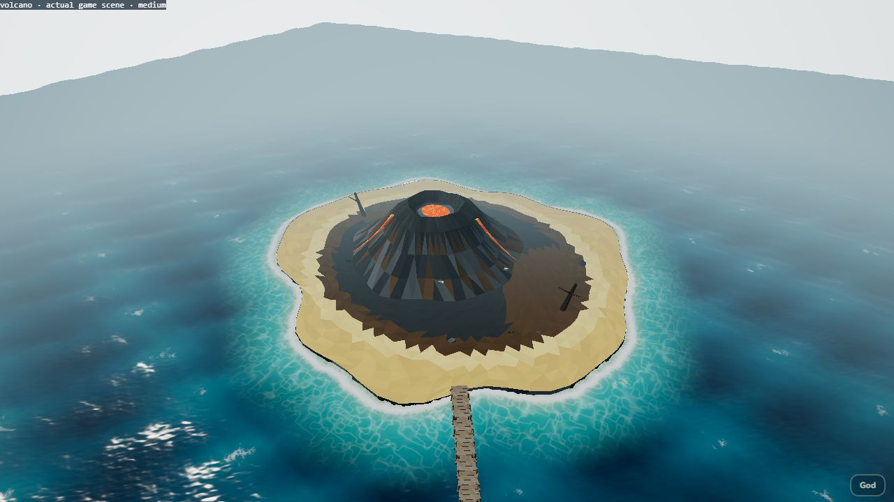
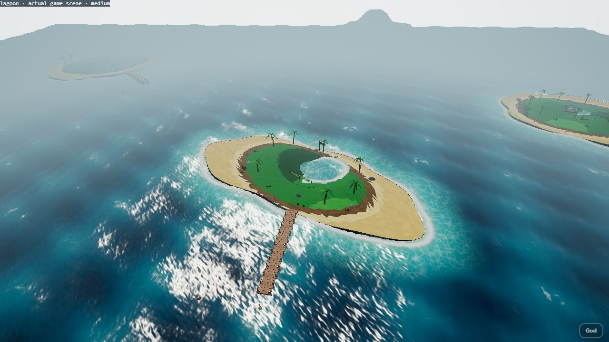
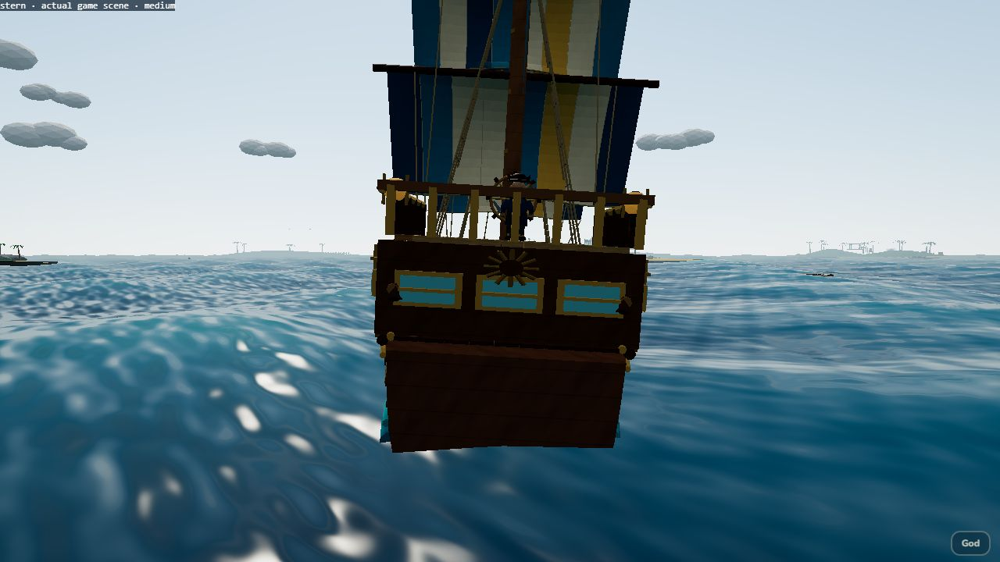
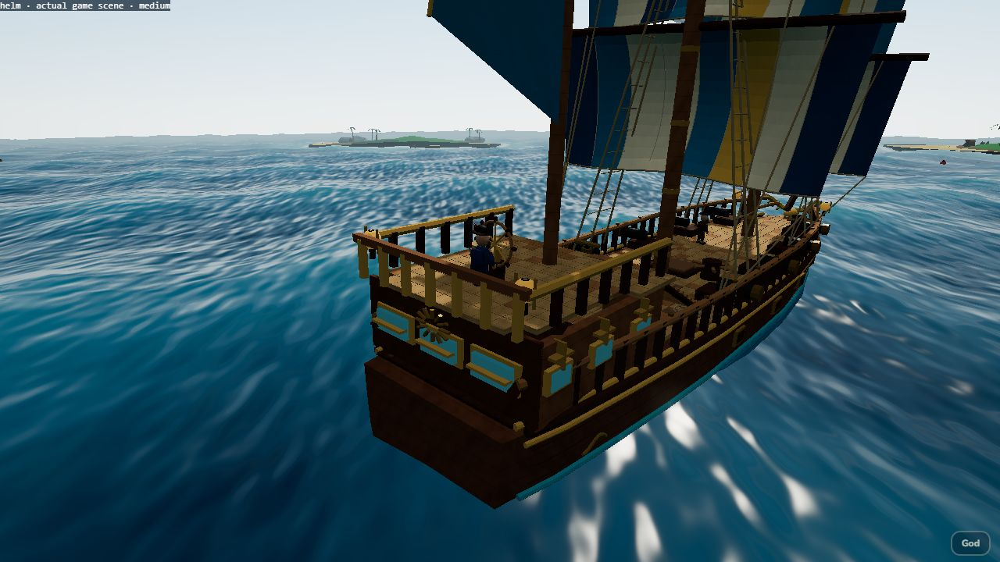

# Острова V3, береговая вода и корма — 2026-10-25

Ветка `codex/islands-v3-stern`, база `67c9f0f` из PR #8 (`codex/morskoy-strannik-v2`). Отдельный PR поверх #8; слияние решает капитан.

## Результат

- Подключены шесть разных GLB из `Pirate_Treasures_Islands_V3.zip`, без изменения исходных файлов (суммарно 4 352 092 байта). Сюжетные острова используют lagoon, cove и volcanic; декорации — crescent, jungle и fortress. Число островов уменьшено с 9 до 6 по просьбе капитана. Названия, координаты и уровни трёх сюжетных островов сохранены.
- Новый адаптер сохраняет окраску вершин и пропорции пальм, построек, руин. Суша масштабируется до прежних игровых габаритов; случайные старые деревья поверх новых моделей не добавляются. Native-причалы на сюжетных островах заменены игровыми, на декоративных сохранены.
- Коллизии учитывают настоящую форму берега через поле расстояний 128×128; открытая бухта больше не закрывается невидимым кругом. Причалы удлинены с 28,8 до 38,4 м, швартовка согласована с берегом и 32-метровым кораблём.
- Море использует это же поле: пена следует контуру, волны не рисуются под сушей. Атлас RGBA8 1024×128 занимает 512 КиБ, расстояние кодируется двумя каналами с точностью около 2 мм; геометрическая точность берега определяется более грубой сеткой, а не кодированием. Неподвижные острова передают атлас один раз после загрузки моделей.
- У исходного конуса вулкана все 784 грани направлены внутрь. Земля теперь непрозрачная и двусторонняя; исправлено исчезновение вулкана и отдельных треугольников сверху. В GLB островов нет отдельных изображений текстур: их поверхность окрашена вершинами. Модели подняты на 0,35 м, как прежние острова; море дополнительно отсечено маской суши.
- Ют, каюта, лестница и связанные детали опущены согласованно. Штурвал уменьшен отдельно и равномерно, капитан сохраняет рост 1,75 м. Добавлена задняя деревянная стенка с тремя настоящими оконными проёмами; окна/декор совмещены со стенкой. Корпус и основные мачты сохраняют размеры.

## Размеры до и после

| Параметр | До | После |
| --- | --- | --- |
| Корпус игрока | 32×7,678 м | 32×7,678 м |
| Перепад главная палуба — ют | 3,491 м | 2,400 м |
| Диаметр круглого штурвала | около 2,37 м | около 1,30 м |
| Капитан | 1,75 м | 1,75 м |
| Игровой причал | 28,8 м | 38,4 м |
| Число островов | 9 | 6 |

## Реально выполненные проверки

- `npm test`: **28/28**. Проверены шесть настоящих GLB, форма бухты, разрешение берегового пересечения, непрозрачность и видимость вулкана сверху, упаковка всех слотов атласа; размеры корабля, три отверстия в стенке, привязки команды, пушки и существующие тесты игры.
- `npm run build`: успешно. Сохранилось прежнее предупреждение об отсутствующем `fonts/fonts.css`.
- WebGL во встроенном браузере, medium: **39/39**. Шесть разных моделей и атлас в реальном мире; швартовка у каждого из трёх причалов обоими направлениями; шесть берегов и три причала; восемь выстрелов, попадания/урон игрока и босса, камера в бою, вход и выход из «три в ряд». [Протокол](islands-v3-stern/browser-checks.json).
- Визуально просмотрены все шесть островов, закрытая корма и капитан у руля. Кадрирование дополнительно просмотрено при 390×844; это браузерный размер, не реальный телефон.
- Фиксированный кадр smoke: 407 вызовов отрисовки, 445 609 треугольников, 588 геометрий, 285 текстур, включая тени и постобработку. Это счётчики сцены, **не FPS-тест**.

## Как проверить в браузере

1. `npm ci`, `npm run dev -- --host 127.0.0.1 --port 5174`. Открыть `http://127.0.0.1:5174/?q=medium`, поднять паруса.
2. Обойти корабль камерой: капитан стоит ступнями на юте у штурвала, корму закрывает дерево вокруг трёх окон. Проверить задний вид и вид с палубы.
3. Через меню God (кнопка или клавиша обратной кавычки) либо плаванием осмотреть три сюжетных острова. Песок/трава и вулкан должны быть сплошными, море — вокруг берега и в водоёмах. Пена не должна образовывать прежнее большое круглое кольцо через сушу.
4. Проверить причал каждым бортом, вход на остров/возврат, залпы и бой. Проверить открытую C-образную бухту, руины и форт, день/ночь и дождь.
5. Для воспроизводимых автоматических действий открыть `/scripts/scale-smoke.html`: ожидается PASS 39. Фикстура сбрасывает прогресс только в памяти сцены, не записывает победы в сохранение.

## Ограничения и следующий этап

- Берег растровый: для крупнейших островов клетка около 1 м. У кромки возможна узкая полоса несовпадения с треугольниками; мелкие камни/постройки пока не имеют отдельных островных коллайдеров. Это судовая береговая коллизия, не система пешей ходьбы.
- Двусторонняя земля исправляет исходный winding, но добавляет нагрузку на GPU. GLB пока без meshopt; размер загрузки вырос. Требуются реальные замеры телефона, FPS/памяти и touch-ввода. Эти проверки **не выполнены**. Полный ручной бой с потоплением также не выполнен.
- Исходные плоские поверхности внутренних водоёмов оставлены; у них заметна треугольная окраска. Полная художественная доработка и контроллер ходьбы не входят в этот этап.
- Высота юта 2,4 м и ступени требуют проверки маршрута ходьбы в следующем прототипе. Проходы 1,5–2 м пока не подтверждены.
- Во время загрузки встречается прежнее предупреждение Three.js `Texture marked for update but no image data found`; инструмент браузера также выдаёт MutationObserver без исходного URL. Успешная визуальная проверка относится к перечисленным сценам, а не доказывает отсутствие всех предупреждений.
- Дорожная карта и аудит здесь не редактировались: новая версия документов идёт отдельным PR #7. Ревью Claude Code и решение капитана фиксируются в HANDOFF после публикации.

## Снимки реальной игры

Остальные виды: [бухта](islands-v3-stern/cove.jpg), [C-остров](islands-v3-stern/crescent.jpg), [руины](islands-v3-stern/jungle.jpg), [форт](islands-v3-stern/fortress.jpg), [390×844](islands-v3-stern/portrait.jpg). Это снимки реализации; сопоставимые снимки старого корабля находятся в отчёте PR #8, исходные ошибки островов показаны капитаном в чате.
