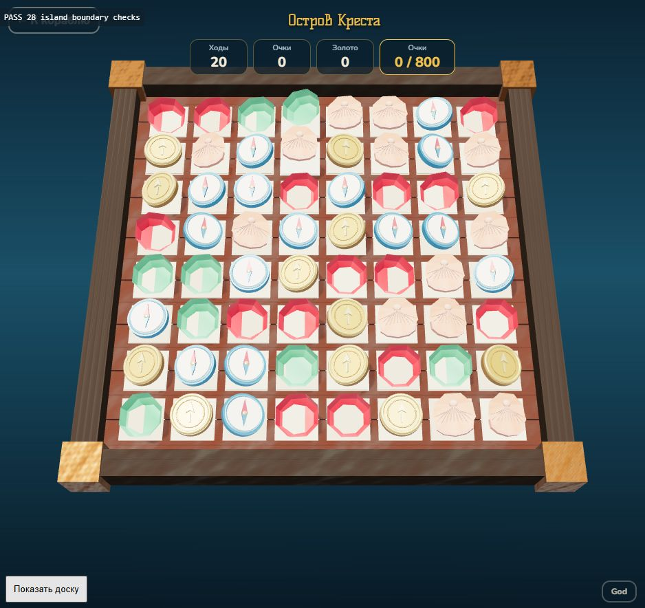

# Граница островной активности

ТЗ капитана подтверждено в чате 26.10.2026: «Начинай реализацию». Ветка `codex/island-boundary` от main `ff4ad75`. Отдельный PR — явное требование этого ТЗ, исключение из обычных пакетов 10–20 задач. Мерж — только по решению капитана.

## Подключение поиска клада

`main.js` отвечает за высадку/швартовку, общий диалог результата, золото, `done`, сохранение и возврат в море. Механика острова подключается регистрацией фабрики:

```js
// src/treasure/activity.js — точка входа в зоне друга
import { registerIslandActivity } from '../island-activity.js';
import { groundHeightAt, islandBounds } from '../island.js';

registerIslandActivity(ctx => new TreasureActivity(ctx));
```

Этот модуль надо один раз импортировать из своей точки входа, например `ui.js`, до первой высадки. Править `main.js` и `world.js` для этого не требуется. Core регистрирует «три в ряд» с `{fallback:true}`: раннюю регистрацию поиска клада он не перезапишет. Сам поиск клада в этом PR **не реализован**.

Фабрика синхронная, её экземпляр переиспользуется между посещениями. Регистрировать активность следует вне посещения; повторная регистрация останавливает прежний экземпляр. Одновременно работает один экземпляр. Обязательный интерфейс:

```js
activity.start(ctx, onEnd); // onEnd({ win: boolean, gold: number })
activity.update(dt, t);
activity.render();
activity.resize(width, height);
activity.stop();
```

`ctx = { isle, def, level, world, renderer, ui }`. `level` — параметры острова с его именем. Контекст заморожен поверхностно; `world`, остров и описание разрешены **только для чтения по контракту**. Это не защитная песочница: не замораживать живой World, не менять `done`, золото, судно или сохранение из активности. Изменение своей сцены, персонажа и UI принадлежит активности.

`resize` может прийти до `start`, фабрика уже получает `ctx` для создания камеры и сцены. `stop` должен выключать ввод, убирать собственный UI и отменять свои продолжения. `onEnd` принимается один раз за посещение; результаты от остановленного/предыдущего экземпляра игнорируются. `win` должен быть boolean, `gold` — конечное неотрицательное число. Управление ходьбой/поиском, камера и остановка собственных анимаций — обязанности будущей активности.

Общий режим теперь `'island'`. Адаптер `src/match3/activity.js` включает прежний HUD через внутренний `ui.mode('match')`, поэтому `ui.js` не изменён. Обычная активность начинает с `ui.mode('island')`, при котором прежние морской HUD и HUD доски скрыты. Названия существующих диалогов результата оставлены как раньше.

Награда, как и раньше, зачисляется при подтверждении общего диалога: победа + «На корабль» ставит `done` и добавляет золото; проигрыш добавляет частичную награду при возврате/повторе, но не завершает остров. Фабрика и новая активность в сохранение не записываются, формат `pirates2-save` не меняется.

## Чтение грунта

```js
const y = groundHeightAt(ctx.isle, worldX, worldZ);
const bounds = islandBounds(ctx.isle);
// bounds: { minX, maxX, minY, maxY, minZ, maxZ } | null
```

- Все координаты в **мировых метрах**, включая высоту. Учтены положение, поворот вокруг Y и масштаб стоящего вертикально острова.
- До готовности fitted-модели запросы возвращают `null`; при необходимости дождаться `ctx.world.kitDone`. Высота также `null`, если в точке нет физического грунта.
- Пальмы, здания, пропсы, водные диски и нижняя искусственная оболочка не участвуют. Отрицательная высота означает подводный грунт. Запрос не переносит точку на ближайшую сушу и не гарантирует сухой/проходимый участок.
- `bounds` — замороженная копия охватывающего прямоугольника/параллелепипеда грунта. Это **не** навигационный контур: бухты, внутренние водоёмы, крутые склоны и препятствия надо проверять отдельно.
- Внутри хранятся CPU-запросы по позиции/индексам физической геометрии до `mergeStatic`. Они не зависят от последующего отсоединения исходных мешей. В сцену и GPU эти query-меши не добавляются, визуальная геометрия не меняется. Высота читается raycast, ускорение для большого числа NPC потребует отдельного профилирования.

## Коммиты

| Пункт | Коммит |
| --- | --- |
| 1. Реестр, жизненный цикл и защита результатов посещения | `3ab9693` |
| 2. Адаптер прежнего Match3, принадлежность отложенного результата | `7932c17` |
| 3. Высадка, общий результат, режим island и возврат | `959066b` |
| 4. God-команды только через адаптер, ленивое создание доски | `cd3b3ee` |
| 5. Чтение высоты/границ в мировых координатах | `eeb8b33` |
| Отмена старого каскада при выходе и интеграционные проверки | `0ea65ef` |

Каждый кодовый коммит прошёл `npm test` и `npm run build`. Первые четыре: 102/102, следующие: 106/106. Отмена по номеру посещения нужна, чтобы отложенное удаление фишки со старым id не удалило новую фишку после повторной высадки. Правила Board и баланс не менялись.

## Воспроизведение

Использовать отдельный тестовый порт **5176**, а не origin сохранения капитана 5174. `/scripts/island-activity-smoke.html` играет настоящий ход, проверяет God-команды, выходит во время каскада, проверяет старую задержанную победу, подставляет фиктивную активность, принимает +10, проверяет проигрыш/повтор/возврат, мировую высоту всех шести островов и загрузку старого формата сохранения. Тест записывает собственный прогресс и явно отказывается работать на 5174. Кнопка «Показать доску» открывает адаптер для визуального осмотра.

Итоговые фактические запуски (Windows, IAB WebGL, 5176):

| Проверки | Результат |
| --- | --- |
| `npm test`, `npm run build` | 106/106, сборка успешна |
| `island-activity-smoke.html` | 28/28 |
| `scale-smoke`, `deck-smoke`, `safety-smoke`, `comfort-smoke` | 39 +34 +17 +7 |
| `physics-smoke`, `v6-smoke`, `waterline-smoke` | 19 +12 +15, включая 12 смоделированных минут шторма |
| `environment-smoke`, `reflection-smoke`, `waves-smoke` | 51 +7 +2 |
| `wake-smoke` | 15 сочетаний трёх качеств и пяти манёвров, шейдеры валидны |

Всего 246 браузерных проверок/сценариев. JSON и снимок: [island-boundary/](island-boundary/). JS сборки 860,10 → 863,24 КБ, gzip 243,46 → 244,60 КБ, новые зависимости/ассеты не добавлены. Прежнее предупреждение `fonts/fonts.css` остаётся. Создание Match3 теперь отложено до первой высадки; время этой инициализации отдельно не измерено. CPU-запросы грунта сохраняют дополнительные буферы физической геометрии, но не добавляют меши/проходы в рендер. Ручное полное прохождение, реальный телефон, GPU-время/память и будущая ходьба по острову не проверялись. Поиск клада, порт, `ui.js`, сохранения, физика, море и `world.js` этим PR не переделываются.


