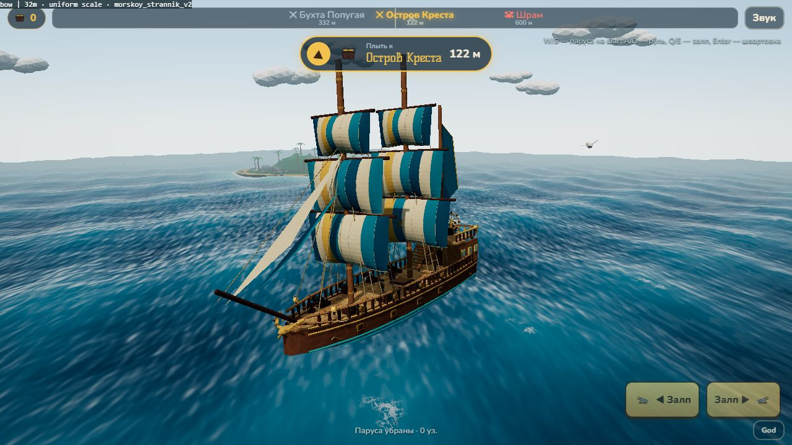
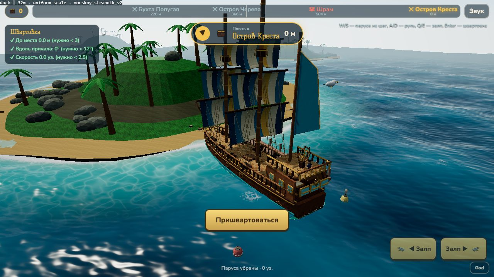
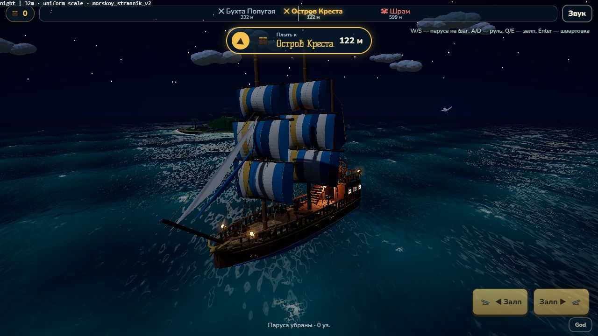
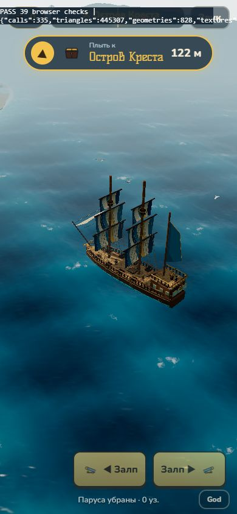

# «Морской странник» V2 — подключение модели игрока

Ветка `codex/morskoy-strannik-v2`, поверх основы TASK 001 (`bd55ef1`). Отдельный PR с базой `codex/brigantine-scale`; PR #6 не переписывается, в main изменения не объединяются без капитана. После принятия #6 целевую ветку нового PR можно переключить на main.

Капитан прислал `morskoy_strannik_v2_review.zip` и явно выбрал **32 м, равномерное увеличение**. Новая дорожная карта/дизайн флота опубликованы Claude в [PR #7](https://github.com/tixzeo/pirate-treasures2/pull/7); это отдельный PR с документацией. Здесь подключён один новый корабль, система покупки/выбора трёх классов не реализовывалась.

## Что заменено

- Активная модель игрока — `public/models/kit/morskoy_strannik_v2.glb`. Старый `player_brigantine.glb` оставлен для регрессионных тестов/отката, в игре больше не загружается. «Каракатица», острова и «три в ряд» сохранены.
- GLB скопирован **без изменения байтов**. SHA256: `B77A2D391065CAD1A168FFA5522A2C1FE47C073F0EEB29466F7C8EEDBE839CC5`. Размер 1 725 536 байт; старый GLB — 85 336 байт. README пакета использован как техническая справка, фактические узлы и геометрия проверены загрузчиком.
- `PLAYER_SHIP`: длина 32 м, масштаб `32/22 = 1,454545` по всем трём осям. Независимого растяжения по ширине нет. Получаются корпус **32 × 7,678 м**, основная палуба в средней части **около 6,780 м**, её верх Y **2,633 м**, квартердек Y **6,124 м**. Значения Y в координатах корабля, до качки/осадки. Ширина несколько больше рабочего ориентира 5,5–6,5 м из PR #7; сохранён выбранный капитаном равномерный масштаб исходной модели.
- Скорость, руль, HP, перезарядка и урон не перенастраивались. Фактическая уязвимость из-за большего корпуса меняется; отдельный баланс боя ещё нужен.

## Адаптер исходного ассета

`src/morskoy.js` работает один раз при загрузке, до объединения статичных деталей:

- Сохраняет сегменты основной и кормовой палуб, отдельные ступени, препятствия и точки команды в `shipParts`. Пушки, стены каюты и ступени, которые в GLB собраны общими мешами, разделяются на связные тела **для данных**, чтобы одна коробка вокруг восьми орудий не перекрыла всю палубу.
- Собирает полосы в **9 целых групп парусов** (6 основных, бизань, 2 носовых), со швами/декором и осями у реев. Одна-две отрисовки на парус, а не отдельная качка каждой полосы. Исходное число треугольников и габариты геометрии до анимации сохраняются.
- Создаёт общие материалы для дерева, ткани, металла и светящихся деталей. Цвета вершин и существующее текстурное детализирование сохраняются; фонари и окна подключены к ночному свечению. Внешние текстуры нового ассета не требуются.
- Скрывает визуальные служебные маркеры дул, сохраняя их для выстрелов. По четыре орудия на борту, точки пересчитываются тем же преобразованием, что и модель.
- Устанавливает капитана у штурвала на кормовой палубе, боцмана и Тима — на главной. Рост персонажей прежний. Автотест проверяет отсутствие пересечений с сохранёнными препятствиями и реальную палубу под ногами через raycast. Тим был переставлен после обнаруженного тестом пересечения с кабестаном.

## Проверки

- `npm test`: **21/21**. Сохранены 16 прежних проверок; добавлены проверки настоящего нового GLB, равномерного масштаба, сохранения геометрии/парусов, восьми дул, раздельных препятствий и точек команды, welding/clone.
- `npm run build`: успешно. Прежнее предупреждение об отсутствующем `fonts/fonts.css` остаётся.
- Встроенный браузер/WebGL, medium: **39/39** в `scripts/scale-smoke.html`. Проверены оба направления швартовки у трёх причалов, берега/причалы, залпы, попадания/урон, режим боя и камера, переход на доску и обратно. [JSON результатов](morskoy-v2/browser-results.json).
- Просмотр в игре: день, ночь со свечением, стоянка у причала, портретный viewport **390×844** (размер дополнительно подтверждён через DOM). Это не тест Android или сенсорного ввода.
- В GLB **129 180 треугольников**. Один medium-кадр smoke-сцены: 446 вызовов, 496 086 треугольников с учётом теней/постобработки. Изменились камера и видимая область, поэтому это не сравнительный FPS-бенчмарк. Новая модель тяжелее предыдущей; LOD, сжатие и реальный телефон — дальнейшая работа.

## Ограничения и приёмка

- Контроллер ходьбы, маршруты/связи ступеней, взаимодействия, выбор класса и прогрессия в этот PR не входят. Наличие лестницы и навигационных данных ещё не доказывает проходимый маршрут нос–корма.
- Масштаб увеличивает также штурвал, поручни, лестницу и детали каюты. Визуальные пропорции относительно капитана 1,75 м требуют оценки капитаном; локальное уменьшение отдельных деталей не делалось.
- Корпус 32 м длиннее существующего причала 28,8 м. Швартовка программно проверена, причалы/геометрия островов не перестраивались. Окончательные стоянки для класса 32 м и баланс боя остаются отдельными решениями.
- Реальный телефон, FPS/память/нагрев, touch, полный ручной бой с потоплением и свободные проходы не подтверждены. До слияния нужны независимое ревью и визуальная приёмка капитана.

## Как проверить

1. Ветка `codex/morskoy-strannik-v2`: `npm ci`, `npm test`, `npm run build`, `npm run dev`.
2. Обычная игра: Поднять паруса; проверить поворот, инерцию, облет камеры и Q/E. В God — День/Ночь для проверки материалов и фонарей.
3. God → каждый остров; встать в контур носом и кормой, проверить Enter/«Пришвартоваться», выход на доску и возвращение. Осмотреть корпус/пушки у причала и поведение при касании берега.
4. God → «Каракатица», сблизиться и проверить бой. Босс должен остаться старой отдельной шхуной.
5. `/scripts/scale-smoke.html` — дождаться `PASS 39 browser checks`. Проверка не завершает победы и не записывает такой прогресс в сохранение.

## Снимки из игры

День, medium; ракурсы носа и причала сняты отдельной проверочной камерой, обычная игровая камера проверена smoke-тестом и в портретном формате.

