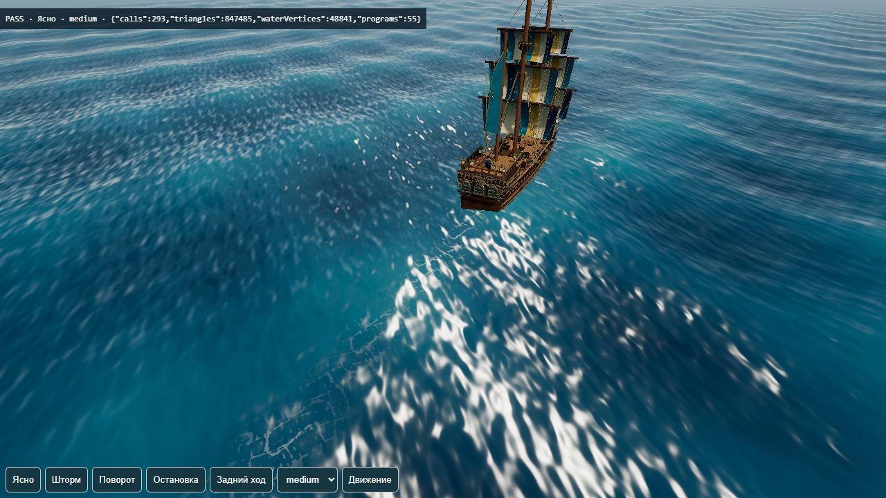
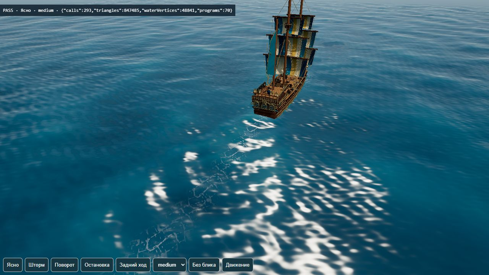
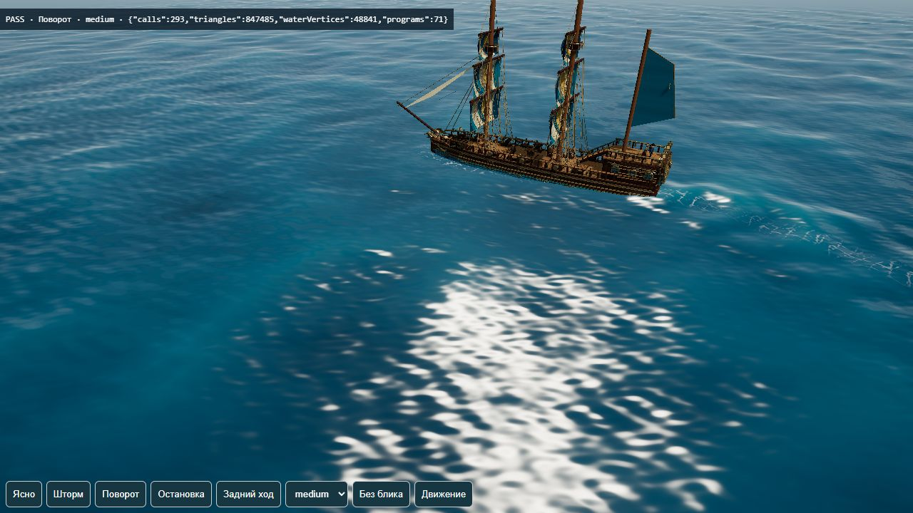

# Разнообразие волн и расходящийся след корабля

Ветка `codex/sea-wave-diversity`, [PR #20](https://github.com/tixzeo/pirate-treasures2/pull/20). Начало пакета 26.10.2026 от `00ac502`; 28.10 капитан поручил исправить существующий PR. В ветку включён актуальный main `1e65d93` с принятой границей островной активности. Codex main не менял.

## Исправления замечаний — 28.10.2026

- `dc35cd1`: корпус исключает из опор воды собственную носовую волну и собственные пакеты истории по идентификатору судна. Океан и волны другого корабля продолжают влиять на него. Рендер воды и плавающие предметы видят все источники. Это убирает обратную связь через собственный след предыдущего шага, не отключая взаимные волны судов. Два регрессионных unit-теста проверяют исключение источника, обе стороны хода и фактический `Vessel`.
- `164350b`: аналитический наклон следа рассчитывается вместе с высотой в вершинах сетки и передаётся в освещение интерполяцией. Из фрагментного шейдера убран повторный обход 28 пакетов и двух носовых волн. Пена и мелкая океанская рябь остались попиксельными. Новых мешей, проходов, текстур и зависимостей нет. Это уменьшение объёма вычислений, а не измеренная прибавка FPS.
- `d0f41ee`: main включён в ветку PR; конфликт HANDOFF разрешён с сохранением обоих отчётов, код границы острова принят без переписывания. Отдельный боевой PR #21 сюда не включён.

Каждый новый кодовый коммит: **107/107 unit и build**. После включения main: **115/115 и build**, JS 867,54 КБ / gzip 246,28 КБ. Предупреждение `fonts/fonts.css` осталось.

Повторено на отдельном origin 5176: GPU-проверка **12/12**, 297 readback, максимальная ошибка компонентов 0,000052; она проверяет и действительный вершинный шейдер моря, включая передачу наклона во фрагментный. **15/15** сочетаний low/medium/high с ясной погодой, штормом, поворотом, остановкой и задним ходом; физика **19/19**; ватерлиния **15/15**, 12 смоделированных минут шторма; берег/бой **17/17**. JSON и снимок поворота: [sea-waves/fixes/](sea-waves/fixes/).

После включения main дополнительно прошла палуба **34/34**. Повторный `island-activity-smoke` не подтвердился: ожидание стартовой анимации доски истекло сначала при 15 с, затем при 60 с в отдельной временной копии фикстуры; третья попытка с 320×180 также завершилась таймаутом. Причина не установлена. Это записано как NOT VERIFIED, успешные старые результаты PR #19 не подставляются вместо текущего прогона. Исходная фикстура и код островной активности не менялись.

Ограничения: наклон следа теперь интерполируется по сетке около 3,18 м и вблизи выглядит мягче прежней непрерывной попиксельной функции. Точная проверка CPU/GPU на малом пробном квадратике не измеряет эту ошибку интерполяции на всей сетке. Взаимные волны кораблей по-прежнему берутся из предыдущего шага мира; собственная обратная связь исключена. GPU-время, FPS на среднем ПК/телефоне, память и полный ручной бой не измерялись. Художественную заметность и ощущение качки принимает капитан. Показатели ниже относятся к исходной версии пакета и не подменяют повторные проверки.

## Исходные задачи пакета

| Задача | Коммит | Результат |
| --- | --- | --- |
| Разбить регулярные длинные гребни | `f6f7126` | Шесть пересекающихся групп вместо четырёх, длины 43/29/19/13/9,1/6,7 м, изгиб фронтов и двумерная огибающая. Доля сильнейшей несущей в сумме квадратов амплитуд 73% → 34%. |
| Расходящиеся волны кораблей | `7627a5d` | Подъём у ведущего конца и расширяющиеся пакеты в пройденных точках. Меняют высоту сетки и нормали, а не рисуют белые полосы. Старые участки не поворачиваются вместе с кораблём, затухают за 6 с. |
| Разорвать рисунок мелкой ряби | `58b54a1` | Изгиб коротких гребней, разные повороты UV двух слоёв, поворот нормалей обратно к мировым осям, ослабление одинаковых мелких бликов. |

Каждый кодовый коммит прошёл `npm test` и `npm run build`: первый 100/100, следующие 105/105. Новых зависимостей и ресурсов нет. Гром остаётся отключён по запросу капитана.

`src/wake-field.js` задаёт общие высоту и аналитические производные JS/GLSL. Плавучесть через `waveHeight` учитывает корабельный след с исключением своего источника для корпуса. Погода усиливает океан, но не корабельный след. Существующий `WakeTrail`: до двух судов, максимум 28 пакетов, фактические скорость/курс, задний ход, остановка, телепорт, исчезновение/затопление. Те же uniform-массивы читает и вершинный шейдер; дальняя плоскость след не рассчитывает.

Это ограниченная процедурная модель, не гидродинамический решатель и не точный спектр Кельвина. Давление у носа/кормы движется с ведущим концом, расходящиеся пакеты рождаются у покидающего воду конца. Центральная пена предыдущего пакета сохранена. Яркие белые пятна на снимках включают солнечный блик: их нельзя целиком считать пеной или доказательством размера следа.

## Фактические проверки

Итоговый код `58b54a1`, реальный WebGL IAB/Windows, отдельный origin **5176**. Сохранение капитана на 5174 не сбрасывалось. Сценарии управляют игрой программно.

| Проверка | Результат |
| --- | --- |
| `npm test` / `npm run build` | 105/105, сборка успешна |
| `waves-smoke.html` | 2/2, 72 GPU-readback: высота/обе производные, ясно/шторм |
| `wake-surface-smoke.html` | 10/10, 288 GPU-readback: малый/полный ход, поворот, задний ход, остановка, затопление, телепорт; максимальная ошибка компонентов <0,000052 |
| `wake-smoke.html` | 15/15 сочетаний low/medium/high × ясно/шторм/поворот/остановка/задний ход, шейдеры валидны, после остановки 0 пакетов |
| Движение в `wake-smoke` | 272 отрисованных кадра за 6,02 с, поворот в движении; это не FPS-бенчмарк |
| `waterline-smoke.html` | 15/15: реальные точки корпусов брига/босса, 12 смоделированных минут шторма, стоянка/полный ход/три курса, полного отрыва в этих расчётах нет |
| `physics-smoke.html` | 19/19: траектории при 5/30/60/144 FPS, торможение и сброс инерции |
| `environment-smoke.html` | 51/51: берег, опоры, пруды, оболочка островов |
| `reflection-smoke.html` | 7/7: low/medium/high, ближнее/дальнее море, восстановление воды после отражения |

Всего 119 браузерных сценариев/проверок, включая 360 сравнений компонентов CPU/GPU. JSON и снимки: [sea-waves/](sea-waves/). Ватерлиния исследует общий шторм; проверки математики/GPU следа не заменяют ручное испытание взаимных волн двух кораблей в бою.

## Стоимость и ограничения

- Сцена следа medium до/после: 48 841 вершина моря, 847 485 треугольников, 293 calls. High: около 1,223 млн, 429–430 calls. Новых мешей/проходов нет, но шейдер дороже: 6 вместо 4 групп и отбор 28 локальных пакетов в вершинах/пикселях. GPU-время и телефон не измерены.
- Широкий отдельный кадр reflection-smoke high: 1 556 669 треугольников /1132 calls, выше цели дорожной карты. Этот пакет не решает LOD/батчинг всей сцены; показатели сцены следа нельзя распространять на весь мир.
- JS сборки 860,10 → 864,14 КБ, gzip 243,46 → 245,02 КБ. Прежние предупреждения о размере чанка и относительном `fonts/fonts.css` остаются.
- Верхняя граница суммы амплитуд океана сохранена (1,05 × погода), но энергия распределена иначе и среднее волнение изменилось. Это меняет ощущение качки; коэффициенты управления/демпфирования здесь не перенастраивались.
- Сохраняется прежнее приближение Герстнера: CPU не решает обратное горизонтальное смещение сетки. Совпадение функции высоты/наклона не означает идеального совпадения любой точки итогового GPU-треугольника. Локальные волны вычисляются в мировых XZ, сетка ~3,18 м дополнена попиксельными нормалями мелких гребней.
- Плавучесть использует след предыдущего шага мира, рендер — обновлённого шага (обычно 1/60 с). Длительная игра, полный ручной бой/маршрут и реальный телефон не проверены. Художественную заметность оценивает капитан.

## Как посмотреть

Набрать ход, посмотреть назад и повернуть: старые пакеты продолжают прежний маршрут, новые расходятся от текущего. После остановки и ещё 6 с след исчезает. На заднем ходу ведущим концом становится корма.

На отдельном тестовом порту открыть `/scripts/wake-smoke.html`: качество, «Ясно»/«Шторм»/«Поворот»/«Задний ход». «Движение» — шесть секунд плавания, «Без блика» меняет время суток для осмотра следа без прямого отражения солнца. Не запускать reset-fixtures на origin капитана.

