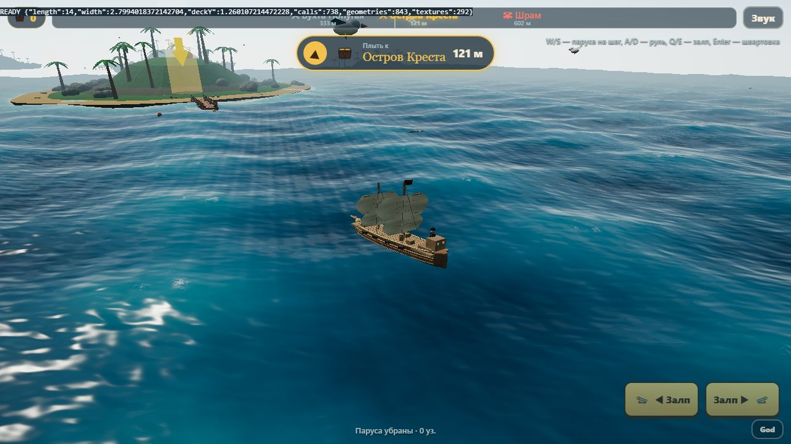
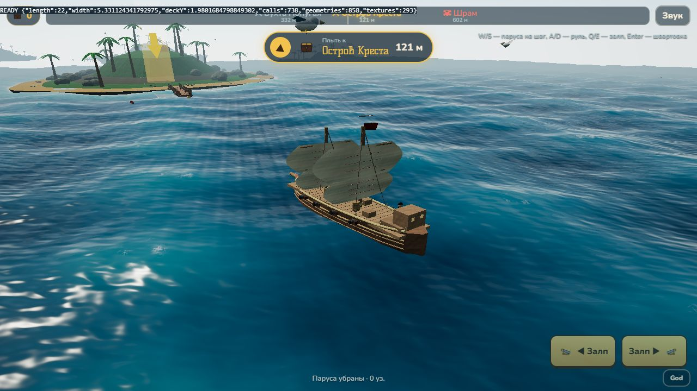
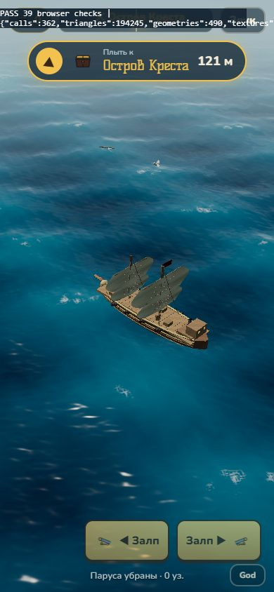

# TASK 001: 22m brigantine and deck scale foundation

The player's 14m brigantine was too narrow for the upcoming deck walking prototype. This change fits its hull to 22m and its main deck independently to 4.4m. Ship-local surfaces, obstacle bounds, gun centres, crew placement, hull collision, hit height and camera use the resulting dimensions. Karakatitsa retains its own model and 15m length; islands, match-3 and combat tuning are unchanged.

Measured GLB dimensions: hull 14×2.799m → 22×5.331m; main deck 12.460×2.310m → 19.580×4.400m; main deck Y 1.260m → 1.980m. Captain stays 1.75m tall. Navigation data is captured before mesh welding, with no extra rendered obstacles. No walking controller or final art pass is included.

Validation: `npm test` 16/16; `npm run build` passed (existing missing `fonts/fonts.css` warning). In-app WebGL browser: 39 smoke checks passed, including every berth in both headings, coast/pier collisions, eight gunshots, damage checks, battle mode/camera, entering and leaving match-3. Desktop and portrait viewport inspected. Real phone, touch input, device FPS/memory and full manual boss fight remain unverified.

Risks: 4.4m deck width does not establish a 1.5–2m clear route. The quarterdeck/cabin remain narrow; the step is now 0.528m and cabin box height 1.54m. Surface/obstacle AABBs are a foundation, not a complete walkable map. Circle coast approximation remains. Independent Claude Code review and captain acceptance are required; do not merge automatically.

See [full report and browser instructions](TASK_001.md), [handoff](HANDOFF.md) and `scripts/scale-smoke.html` (dev server only).

Before / after: identical fixed camera, day/clear, medium, 1280×720. Normal gameplay camera scales separately.

