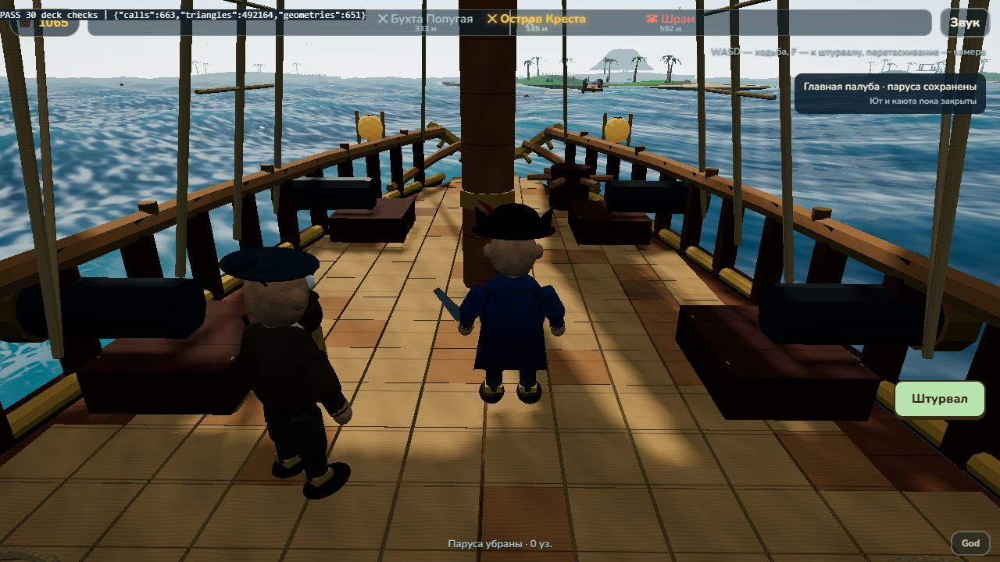
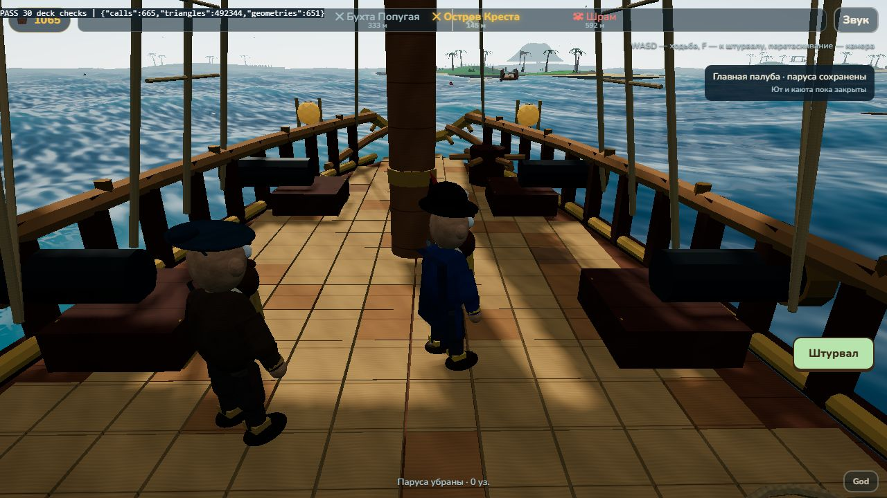
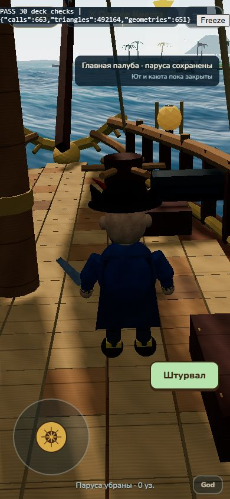

# TASK 002 — ходьба по главной палубе

2026-10-25. Ветка `codex/deck-walk`, база `1106272` из PR #9 (`codex/islands-v3-stern`). Прототип готов к независимому ревью и проверке капитаном; окончательная приёмка пока не состоялась.

## Основание и границы

Капитан поручил после предыдущей работы найти TASK 002 — Deck Walk и продолжить самостоятельно. Полное задание найдено в готовом архиве `pirate_task_002_deck_walk.zip`. В нём описана более ранняя 22-метровая техническая модель и предпосылка слияния PR #6. Текущая модель уже заменена капитаном на 32-метрового «Морского странника», поэтому прототип подготовлен поверх текущей проверенной ветки #9; main и PR #6/#7/#8/#9 не сливались. Контроллер использует данные корабля, а не число 22 или 32.

По отдельному указанию капитана четыре замечания к PR #9 отложены на потом: проверка места стоянки вдоль пирса, параметры подгонки кормы, сжатие островов и форма нижней части кормы. Этот PR их не исправляет.

## Поведение

- В морском режиме **F** или кнопка **Палуба** переводят управление на капитана. **WASD/стрелки** перемещают его относительно судна; перетаскивание вращает камеру, колесо меняет дистанцию. На узком экране/при touch показывается джойстик.
- **F / Штурвал** возвращают капитана на его прежнюю точку у руля и восстанавливают обычную или боевую камеру. Положение на главной палубе запоминается до следующего входа в рамках текущей сцены; после сброса выбирается новая безопасная точка.
- Паруса сохраняют прежнюю установку. WASD и джойстик в режиме палубы не управляют парусами/рулём, корабль продолжает идти и качаться. Руль получает нулевое намерение; его физическое затухание остаётся прежним.
- Залпы доступны у штурвала; в режиме палубы кнопки спрятаны, Q/E и прямой `world.fire` заблокированы. Видна подпись режима и ограничение доступа к юту/каюте.
- Диалог, швартовка, переход в «три в ряд», телепорт, сброс, ремонт, смерть/затопление или смена навигационных данных безопасно завершают ходьбу. Потеря фокуса и смена управления очищают клавиши/захват джойстика. Сохранения не меняют схему; координаты прогулки между перезапусками не сохраняются.

## Реализация

- `deck-walk.js`: чистые расчёты движения/столкновений, безопасный spawn и разделение клавиатурного/экранного ввода. Капсула приближена горизонтальным кругом радиусом **0,32 м** с вертикальным интервалом **1,75 м**; до края добавлено **0,18 м** запаса (центр не ближе 0,50 м). Препятствия учитываются только при пересечении по высоте. Низкие люки и пушки остаются препятствиями, предметы полностью под полом не блокируют.
- Скорость **2,4 м/с**, диагональ нормализована, `dt` ограничен 0,1 с, подшаг не длиннее 0,128 м. Раздельные оси дают скольжение у препятствий и предотвращают прохождение тонкой мачты при скачке времени.
- `ship-layout.js` снимает выпуклый контур верхних вершин палубы до сварки мешей и преобразует его тем же масштабом, что и поверхность/пушки. Одного непроверенного AABB недостаточно для включения ходьбы. Четыре окрашенных фрагмента «Странника» описывают один основной пол, теперь объединённый в одну логическую поверхность; три исходных фрагмента сохранены как `deck-part`.
- Доступна главная палуба перед лестницей: передняя граница ступеней ограничивает кормовой проход. Сами лестницы, ют, внутренняя каюта, прыжки, бег и островная ходьба не реализованы.
- Тот же экземпляр капитана остаётся дочерним объектом судна. Переключаются существующие Idle/Walk с коротким переходом; анимация не запускается заново каждый кадр. Существующий mixer обновляется один раз.
- `deck-camera.js` сглаживает положение в системе корабля и только затем переводит его в мир; проверяет отрезок до камеры против трёхмерных AABB мачт/каюты/ступеней. Орбитальная камера корабля сохраняется отдельно.
- GLB, материалы, острова, причалы, правила боя и «три в ряд» не переделаны. Новых зависимостей и отрисовываемых коллайдеров нет.

## Фактические проверки

- `npm test`: **37/37**. Движение при разных dt, диагональ, скачки времени, тонкое препятствие, скольжение, высотное пересечение, сужение носа, безопасный spawn, блокировка кормового перехода, камера и parenting. На настоящей модели проверен замкнутый обход мачты. Расчёт проверен также при длинах 22/32/46 м на этом же GLB — это тест переносимости расчёта, а не три реализованных класса кораблей.
- `npm run build`: успешно; прежнее предупреждение `fonts/fonts.css`.
- Реальный WebGL, medium: **30/30** в `scripts/deck-smoke.html` и **39/39** регрессий в `scripts/scale-smoke.html`. Проверены F/UI, разделение ввода, паруса при движении судна, Idle/Walk, край, выстрелы, диалог/смерть/телепорт/сброс, бой, швартовка и вход/выход из match-3. В измеренной Idle-позе нижняя точка анимированной обуви на ~5 мм выше поверхности.
- Портрет **390×844**: выполнено реальное удержание экранного джойстика указателем браузера 700 мс. Капитан сместился примерно с `(0,161; −4,869)` до `(1,297; −5,950)` м; паруса остались 0, руль 0. Отпускание остановило ходьбу, экранная кнопка вернула к штурвалу. Это проверка pointer-событий в браузере, не измерение настоящего touch-устройства.
- Итоговый кадр Idle, medium: 663 draw calls, 492 164 треугольника, 651 геометрия, включая тени и постобработку. Сцена и ракурс отличаются от прежней морской камеры; это **не сравнительный FPS-бенчмарк**.
- [30 проверок](task-002/browser-checks.json), [39 регрессий](task-002/regression-checks.json), [протокол джойстика](task-002/mobile-pointer.json).

## Проверка капитаном

1. Запустить `npm ci`, `npm run dev`, открыть `/?q=medium` и поднять паруса. У штурвала W/S меняют паруса, A/D — руль, Q/E — залп.
2. Нажать F/Палуба. Обойти мачту, пушку и люк, подойти к бортам/носу/лестнице. Камера должна следовать за капитаном, края и видимые препятствия — останавливать его.
3. Сначала задать паруса, затем включить ходьбу. Судно продолжает идти, капитан остаётся на палубе, WASD не меняет паруса. Проверить Idle/Walk, вращение камеры и возврат F/Штурвал.
4. Проверить швартовку обоими направлениями, доску/возврат и бой со Шрамом. В бою можно выйти на палубу, но для залпа нужно вернуться к штурвалу.
5. Повторить джойстик и кнопку на телефоне. Записать устройство, качество, PR/коммит и способ воспроизведения ошибок.
6. Автоматические фикстуры: `/scripts/deck-smoke.html` (PASS 30), `/scripts/scale-smoke.html` (PASS 39). `?manual` включает живое управление после проверки, Freeze фиксирует кадр; `?mode=walk` даёт кадр анимации Walk. Фикстуры не записывают победы в сохранение.

## Ограничения / NOT VERIFIED

Реальный телефон, мультитач двумя пальцами на устройстве, FPS/память и полный ручной бой с потоплением не проверены. Камера использует простые коробки и ограниченную дистанцию, а не точное пересечение со всеми верёвками и декором; в тесных местах она приближается. Нет физики падения, foot IK, навмеша, ходьбы по лестнице/юту/каюте и взаимодействий с оборудованием. Новым моделям понадобится проверенный контур и препятствия; одна прямоугольная рамка не включает ходьбу автоматически. Проходы 1,5–2 м и одновременный обход всех персонажей не объявляются подтверждёнными.

Сохранены прежние предупреждения загрузки текстур Three.js; инструмент браузера иногда сообщает MutationObserver без исходного URL. Проверены перечисленные сцены, а не все состояния графики/ввода.

## Снимки

