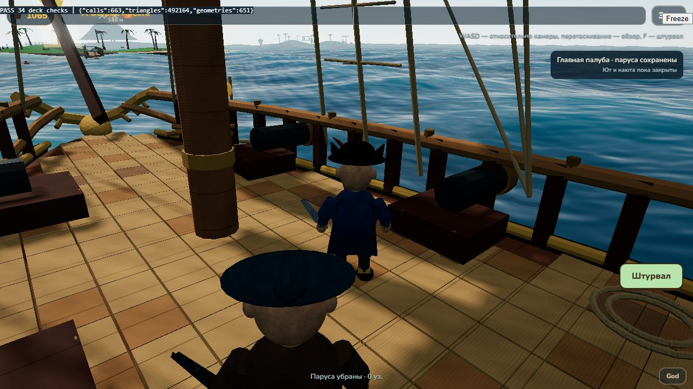
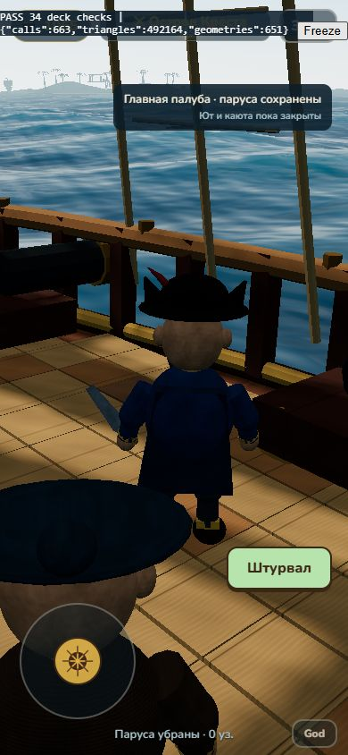

# Камера третьего лица — 2026-10-25

Ветка `codex/third-person-camera`, база `104ebd9` из PR #10. Капитан выбрал управление **WASD относительно экрана, мышь/свайп поворачивают обзор**. Камера привязана к положению капитана; её свободный азимут сохраняется, персонаж поворачивается по фактическому движению. Это отдельный PR поверх `codex/deck-walk`, без слияния с main.

## Изменения

- В режиме палубы клавиши и джойстик преобразуются из экранных направлений в координаты судна. После разворота обзора на 90° или 180° W продолжает вести вперёд по видимому направлению, D — вправо по экрану.
- Используется направление реально показанной камеры, а не конечная цель сглаживания: быстрый свайп не переключает ходьбу до поворота обзора.
- Положение точки слежения сглаживается в системе корабля. Азимут, наклон и дистанция сглаживаются отдельно; быстрый разворот на пол-оборота проходит по дуге вокруг персонажа вместо прямого пересечения через его тело. На границе ±π выбирается короткая дуга.
- Сохранены прежние ограничения камеры по препятствиям, радиус/скорость/коллизия капитана, анимации, F/экранный возврат к штурвалу. Морские управление и камера используют прежний путь.
- Обновлена подсказка на экране. Дополнительных мешей и зависимостей нет.

## Проверки

- `npm test`: **41/41**. Новые проверки: четыре направления обзора, величина аналогового ввода, совпадение движения с фактическим взглядом при качке/повороте судна, быстрый полуоборот, переход через ±π и сохранение столкновений.
- `npm run build`: успешно; прежнее предупреждение `fonts/fonts.css`.
- WebGL medium: **34/34** в `scripts/deck-smoke.html`, включая настоящие клавиатурные W после обзора на 90°/180°; **39/39** прежних регрессий.
- 390×844: указателем браузера перетянут обзор примерно на −43°, затем удержан джойстик вперёд 700 мс. Капитан прошёл примерно `(Δx=+0,717; Δz=−0,769)` м — по новому взгляду; паруса и руль сохранились на 0. Это pointer-проверка в браузере, не тест настоящего телефона.
- [34 проверки](third-person/browser-checks.json), [39 регрессий](third-person/regression-checks.json), [экранный ввод](third-person/pointer-check.json).
- На реальном телефоне, с мультитачем и при измеренном FPS/памяти не проверено. Прежние ограничения приближённых коллайдеров камеры сохраняются.

## Проверка капитаном

Включить Палубу/F. Перетянуть обзор мышью или свайпом в сторону, затем нажать W: капитан должен идти по направлению взгляда, A/D — в стороны экрана. Проверить то же джойстиком, обход мачты, полный разворот обзора и возврат F/Штурвал. Колесо сохраняет изменение дистанции.

## Согласованные следующие задачи

1. По [решению из PR #10](https://github.com/tixzeo/pirate-treasures2/pull/10#issuecomment-6400602661), подтверждённому капитаном в чате: после камеры, **отдельным PR**, добавить пороговый урон/звук удара о берег, запретить вход на палубу в бою и возвращать к штурвалу при начале боя. Прогулка под парусами сохраняется.
2. Затем исправить наложение океана на закрытые водоёмы, соединить основание вулкана с землёй и увеличить острова **в 3 раза по ширине и длине**. Проверить размещение островов, береговые коллизии и подходы к причалам; сохранить человеческий масштаб пропсов. Эти изменения в текущем PR ещё не реализованы.
